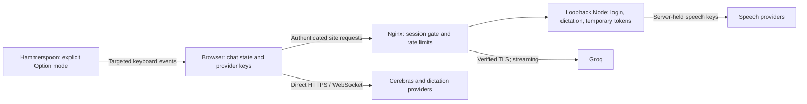

# Hi-chat code, security and latency audit

Date: 2026-10-11. Baseline: main at `16f0335e` (PR #56).

The application does not need another broad rewrite to make answers arrive faster. Its useful foundations—streaming, provider racing, cancellation, and a reusable Groq proxy connection—already exist. The priority is to repair permission boundaries, remove avoidable display waits, and measure the remaining network/provider delays before changing the model strategy.

This review covers the deployed web application, nginx/Docker, Node authentication and dictation relay, Markdown rendering, MCP execution, Auto answer modes, dependency advisories, and the Hammerspoon background-typing helper. It is a source review with automated regressions, not a penetration-test certification. Desktop/mobile native services and every optional provider SDK were not exhaustively audited. No fresh Railway log connector or production provider credentials were available here. Deployment status is checked separately through GitHub; production latency numbers are not inferred from local tests.

## Architecture and trust boundaries

The login protects access to hosted pages and proxied APIs. It does not encrypt the browser's local provider-key storage or protect against code executing inside the site origin. nginx is the public enforcement boundary; Node binds to loopback and must not be exposed as a second public service. Direct provider requests retain those providers' authentication requirements.

## Verified findings and changes

| Priority | Evidence in baseline | Consequence | Implemented change |
| --- | --- | --- | --- |
| High, when MCP is enabled | `postMessageProcessing` constructed the tool promise before examining `approved` | A denied action could execute; only its result was hidden | Invoke only after approval. No approval handler means denial. Stop during approval or server lookup prevents invocation. Rejected browser tools cannot trigger proactive capture. |
| High, untrusted raw HTML boundary | `RenderMarkdown` enabled `rehypeRaw` for external content without sanitization | Active embedded HTML can enter model/readme presentation; ordinary chat had raw HTML disabled | Parse then sanitize using an allowlist before KaTeX. Remove iframe, script, form and active inputs while retaining text/math. Fix memoization so changing the HTML mode takes effect even when content is identical. |
| High, transport confidentiality | nginx set the Groq TLS name but did not enable certificate verification | An upstream certificate was not authenticated | Enable certificate verification against installed CA roots and retain SNI, session reuse, keepalive and streaming. |
| Medium, browser request boundary | Login POSTs, temporary speech-key requests and live upgrades had no explicit Origin check | Cross-origin browser operations could reach sensitive endpoints when cookies/policies permit | Reject foreign/malformed/null origins and cross-site Fetch Metadata. Forward the public Host to Node. Non-browser callers can omit Origin; this is not authentication or bot protection. |
| Medium, relay availability | Fragment size was capped, but aggregate fragments and held audio were unbounded | An authenticated faulty/malicious client could consume relay memory | Limit aggregate messages, fragment count, queued audio and write backlog to bounded amounts; validate masking/control frames/handshake; stop upstream readiness waits after 10 seconds. |
| Medium, retained private data | Speech diagnostics logged transcripts; browser console logged complete tool arguments | Conversation contents and possible secrets remained in logs | Default relay logs retain timing/length metadata, not transcripts. `SPEECH_LOG_TEXT=1` explicitly enables text diagnostics. Remove raw/parsed tool argument console logging. This does not remove historical logs or provider-side retention. |
| Medium, stalled work | The 200-second transcription timer only aborted; an engine ignoring abort could leave the race unresolved | Hanging uploads and resource retention after cancellation | Deadline resolves the race even if an engine never settles. Cancel active engine work when the HTTP client disconnects. Keep the existing production ceiling; do not silently sacrifice long-recording support. |
| Correctness and latency | Groq transport accepted the first HTTP response, including an error; cancellation depended on fetch cooperating | A fast 503 could beat a healthy alternate; Stop could hang or fail to stop the response body | Prefer successful responses, retain a useful error if both routes fail, resolve cancellation immediately, keep Stop linked after response headers, discard late losing bodies. |
| Display latency | Streaming depended solely on animation frames and prompt-progress chunks imposed a 100 ms wait | Hidden/inactive tabs can postpone display; artificial waits slow progress | Show first useful answer text immediately. Batch subsequent updates using animation frames with a nominal 40 ms timer fallback. Remove the artificial wait and cancel queued display work on Stop. |
| Completion request correctness | Reassigning the optional thread model lost type narrowing; the manual nonstreaming provider call omitted the Stop signal | Strict type errors and inconsistent cancellation | Snapshot the resolved model ID, preserve vision routing, and pass the abort signal to nonstreaming requests too. |
| Memory/render correctness | A module cache retained up to 100 growing Markdown prefixes; memo compared only text | Avoidable retained answer content and stale rendering props | Keep only component-local memoization and use normal shallow prop comparison. |
| Native input safety | Background typing did not check macOS Secure Input | The indicator could remain enabled when event routing is unavailable | Refuse/start-stop routing when Secure Input is enabled. Preserve the pinned-window checks and explicit Option toggle. |
| Security test coverage | CI ran only `relay/server.test.mjs` | Authentication and new security regressions could be skipped | CI runs all `relay/*.test.mjs`. |

The highest-impact issue is tool execution before approval. Its severity depends on MCP availability and installed tools; the web platform already restricts several native features. The regression verifies that the invocation itself never occurs, rather than merely checking a displayed rejection.

Raw HTML sanitization is a real boundary improvement, not a claim that every baseline script tag executed. React/Markdown already block some constructs. Sanitization now removes additional active constructs such as frames/forms; KaTeX runs afterward with its own default untrusted-input protections and a patched version.

## Dependency study

The recursive production-workspace registry scan returned **133 vulnerability records and 14 deprecation records** before changes. There were 11 critical, 70 high, 44 moderate and 8 low vulnerability records. These are package/advisory records, not 133 distinct production exploits. Workspace dependencies include build/test tooling even though the final Docker image copies only static web output plus the dependency-free Node relay.

Safe, focused dependency fixes:

- `mdast-util-to-hast` 13.2.0 → 13.2.1, patching unsanitized class-name handling.
- Prism 1.27.0 → 1.30.0 for the older transitive copy, addressing DOM-clobbering behavior.
- Seroval 1.3.2/1.4.0 → 1.6.9, addressing multiple deserialization/resource-consumption advisories. There is no server-side React rendering in this deployment, so advisory severity alone does not establish that its JSON-deserialization attack path was reachable.
- KaTeX 0.16.22 → 0.18.2, the advisory's fixed version. This crosses a minor boundary in a pre-1.0 package; explicit resolutions align the direct dependency and Markdown plugins, with math/render regressions and production build validation.
- Add `rehype-sanitize` 6.x for the external-HTML boundary.

The post-change scan reports **122 vulnerability records** (9 critical, 64 high, 42 moderate, 7 low), plus the same 14 deprecation records. All advisories for the four patched Markdown/serialization packages are absent. This is an 11-record reduction, not a clean dependency bill of health.

The machine-readable [advisory inventory](security-advisories-2026-10-11.json) captures both baseline and post-change scans. Remaining packages include XML/form-data dependencies of optional SDKs, npm/build tooling, dev-server/test dependencies, and other transitive packages. They are not declared safe merely because they are outside the main Groq/Cerebras path. Some require parent SDK/toolchain updates and broader compatibility testing. Do not force incompatible major versions globally to make an audit counter green.

Next dependency work: remove unused provider adapters from the web build, separate build tools from runtime dependencies, upgrade parent SDKs in isolated changes, run the scan in CI with an explicit reviewed baseline, and scan the final Docker image/OS separately. This review did not run an image CVE scanner.

## Remaining security work

| Item | Why it remains | Recommended design |
| --- | --- | --- |
| Browser-persisted provider API keys | Current BYOK settings use browser local storage; any same-origin script compromise can read them | For this single-user deployment, move Groq/Cerebras credentials into Railway secrets and a narrowly scoped backend gateway. Preserve a distinct BYOK path only if needed. Do not silently copy existing browser keys to a server. |
| Long-lived sessions | Auth cookie lasts 365 days; no per-device server revocation | Shorter configurable sessions, dedicated `AUTH_SECRET`, and per-device revocation. Changing the secret logs existing sessions out. |
| OTP availability | Five-code/hour and five-try controls are global; anonymous requests can consume the legitimate user's budget | Per-source and per-account limits using correctly configured trusted proxy addresses; retain a global safety cap. Origin checks are not a defense against bots. |
| Strict CSP | Third-party providers, workers, math and image/upload rendering need a tested policy; there is no comprehensive CSP | Introduce report-only CSP first, inventory allowed origins, then enforce with explicit worker/style/connect rules. |
| Header inheritance | nginx locations with their own `add_header` do not inherit every server header | Consolidate a shared tested header include; verify on login, assets, APIs and error responses. Avoid treating legacy `X-XSS-Protection` as a modern defense. |
| WebSocket parser maintenance | Custom RFC6455 handling is bounded now but is not a complete maintained protocol implementation | Replace with a maintained, currently patched server library in a separate change, including close/UTF-8/protocol conformance and queue tests. |
| Proactive capture | Explicit proactive mode can run screenshot/snapshot tools after an approved browser action | Keep default off; make the additional capture permission clear and review which installed tools match by name. |
| Secret/history lifecycle | Chat/history/provider settings and old speech logs can retain sensitive material | Document deletion/retention, review Railway log access and retention, and add safe export/redaction controls. Disabling new transcript logs does not erase old records. |
| Runtime/image updates | Docker bases float; CI Node, builder Node and runtime Node are not a single pinned matrix | Pin an intentionally updated image/runtime matrix, scan images, and test the native WebSocket client/header support on that runtime. |

## What holds back lower latency

The relevant metric is **send → first useful visible answer**, not first HTTP headers or first reasoning token. Dictation adds **stop recording → usable transcript → send** before that metric. Browser painting can still be throttled when hidden even after JavaScript state updates.

| Stage | Current design | Remaining cost | Best next step |
| --- | --- | --- | --- |
| Answer selection | Speed races Groq 20B, Groq 120B and Cerebras 120B; Accuracy races the two 120B models with 20B recovery | Provider queue, prompt size, reasoning, parallel-token cost | Benchmark p50/p95 useful-answer time and correctness on the same saved question set. Larger-model preference is not a correctness judge. |
| Network | Groq direct-first with server route joining after 1 second; nginx reuses connections and streams | Safari stalls, proxy detour, duplicate work | Retain hedging; measure route winners before reducing the join delay. Faster hedging increases requests/cost and rate-limit pressure. |
| Failure recovery | Auto attempt deadline is 8 seconds; Accuracy can then start an 8-second recovery | Roughly 16 seconds in an all-slow/failing case | Keep healthy fast paths immediate; tune recovery deadlines using real failure data, not a global forced timeout. |
| Prompt preparation | Conversation history plus attachments/tools are assembled before sending | Large history increases upload, provider prefill and tokens | Add a model-aware context budget and cached summary of older turns. Preserve recent exact questions, system rules and unresolved tool results. Avoid a new summary model call on every send. |
| Cold load | Production main JS is ~3.85 MB (1.20 MB gzip); model metadata chunk ~1.30 MB (275 KB gzip) | Download/parse/hydration before the first interaction; bundle-size warning | Lazy-load optional SDKs/model catalogs and heavier renderer features. This improves cold startup, not an already-open provider generation. |
| Streaming UI | First useful text is immediate; later batches use frame/timer scheduling | Full Markdown/math/syntax highlighting can still consume CPU on long outputs | Profile representative long answers. Consider plain-text incremental rendering for the unfinished final block, then full Markdown when stable. |
| Dictation | Live streaming, automatic competing transcripts, agreement shortcut; first useful transcript opens a ~1 second grace; disagreements can invoke a judge | Up to 8 seconds for live finalization, comparison/judge time, batch fallback | Offer an explicit fast transcription profile (first reliable final text) and accuracy profile (agreement/judge), keeping Retry and failed-audio recovery. Do not silently trade accuracy for speed. |
| Tool use | Winning answer stream can invoke tools after approval | Actual tool round-trips and approval time | Keep approval secure. Cache safe schemas/discovery and parallelize only genuinely independent approved calls. |

Streaming is already enabled for Auto. Enabling streaming on a manually selected assistant that disables it can improve perceived latency. Streaming does not shorten model prefill/queue time or guarantee a correct early token.

A server gateway for Groq/Cerebras is feasible and would also improve credential isolation. It should implement provider streaming directly, propagate aborts, use connection reuse, enforce request/token budgets and structured diagnostics, and avoid a mandatory routing/judge request before every answer. It needs actual Railway secret configuration and latency measurements; adding a gateway alone can add a network hop.

Suggested benchmark acceptance targets, not current measurements: p50 useful answer under 1 second and p95 under 3 seconds for short, healthy-network prompts; measure long-history and provider-failure cases separately. Keep correctness scoring and token/cost results beside timing results. Report dictation stop-to-transcript independently so audio finalization is not misattributed to the answer model.

## Validation and operational notes

Local validation: **129 web test files passed, 1,537 tests passed and 1 skipped; 37 relay/auth/security tests passed; final completion regressions (25 tests) passed; strict app TypeScript and immutable dependency install passed; portable Hammerspoon syntax and routing/dictation shortcut checks passed; production web build passed.** Focused regressions cover denied/missing/aborted tool approvals, successful-vs-error transport races, pre/post-header cancellation, immediate/background stream flushes, raw HTML sanitization and math, HTTP Origin rejection, WebSocket framing and queue bounds, transcription deadlines/cancellation and log redaction.

Native Hammerspoon checks validate callbacks without app activation. Actual Safari input delivery, keyboard layout/IME behavior, macOS Secure Input transitions, main-window dimming and the visible indicator require a Mac. Replace/reload `scripts/hammerspoon/jan-remote.lua` there; changes to a repository cannot modify the user's Mac automatically.

The build retains existing peer-range and large-bundle warnings. The nine baseline strict TypeScript errors in `completion.ts` were resolved by retaining the validated model ID across vision routing; `tsc --noEmit -p tsconfig.app.json` now passes and is included in CI. This check excludes test files and does not establish that every desktop/mobile platform is clean.

Operationally, leave `SPEECH_LOG_TEXT` unset for metadata-only speech logs. Enable `1` only when deliberately collecting transcript diagnostics; this is a server setting and does not prevent browsers/providers from retaining their own conversation data.
